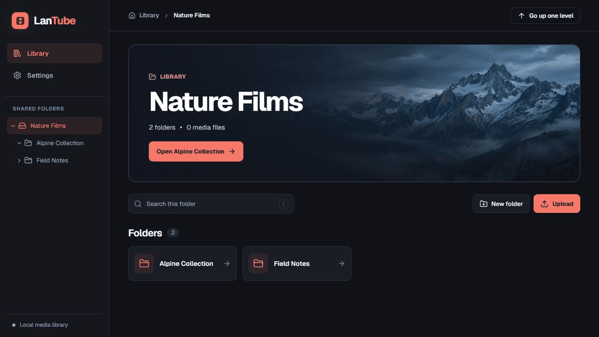

# LanTube

[简体中文](README.zh.md)

I have always had such troubles：

> Videos downloaded on the Internet（cannot be posted to public platforms due to copyright issues）,
> need to be played on computer and mobile phone (tablet),
> But don’t want to copy the video to each device, so there is this project.

---

This is a LAN video server, which can be deployed on any device (with operating system) in the LAN (even Raspberry Pi)

* Computer（Windows, Linux, Mac）
* MobilePhone or tablet
* RaspberryPie

---

# Features

* Navigate shared folders with a directory tree, breadcrumbs and search within the current folder.
* Browse video frames in the library and the play queue. Playback and thumbnails use the codecs supported by your browser.
* Upload files, create folders and switch between English and Simplified Chinese.
* Play the queue automatically or manually, with a sleep timer.



# Build

Install a current stable Rust toolchain, a linker for your target platform, and Node.js 24.11 or newer with npm. Run this command from the repository root. [Rust](https://www.rust-lang.org/) · [Node.js](https://nodejs.org/)

```sh
cargo build --release
```

Cargo installs the locked frontend dependencies, builds the UI and embeds it in `target/release/lantube` (`target/release/lantube.exe` on Windows). Copy that executable to a machine with a compatible OS and architecture. Node.js, npm and the frontend files are only needed when building from source.

## Run

Start `lantube` (or `lantube.exe`) and open [http://127.0.0.1:8888](http://127.0.0.1:8888). With the default settings, LanTube listens on localhost and uses a `share` directory next to the executable if one exists. Create the directory and restart LanTube to use it.

To enable access from other devices on a trusted LAN or choose other media directories, use [config.example.toml](config.example.toml) as a template for `config.toml`. LanTube looks in the current working directory first, then beside the executable. Relative media paths are resolved from the configuration file's directory. The example listens on `0.0.0.0:8888`.

Compatible playback and server-generated thumbnails require `ffmpeg` and `ffprobe` on the server's `PATH`, from FFmpeg 6.1 or later, with `libx264` enabled. Put the tools in an absolute `PATH` directory outside your media folders before starting LanTube. LanTube tries to generate H.264/AAC segments and thumbnails on demand when the browser cannot decode the video. You can also select **Compatible playback** below the player. The server reads the source files as-is.

---
如果您对股票，期货，外汇等金融交易感兴趣

欢迎加入`交易奇才 Slack 交流群`，让我们一起成为更好的交易者！


> 可扫码关注公众号，并回复：**加群**
