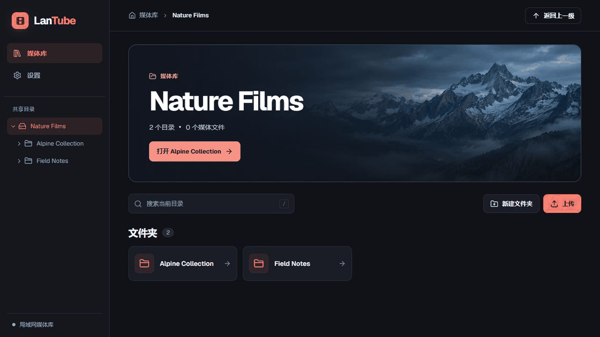

# LanTube

一直以来总有这样的困扰：

> 在网络上下载下来的视频（因为版权问题无法发到公共平台），需要同时在电脑和手机（平板）上播放，但又不想把视频拷贝到各个设备上，于是就有了这个项目。

---

这是一个局域网的视频服务器，可以部署在局域网内的任何（有操作系统的）设备上（甚至是树莓派）

* 电脑（Windows, Linux, Mac）
* 手机平板
* 树莓派

---

# 特性

* 使用目录树、面包屑和当前目录搜索浏览共享目录。
* 媒体库和播放队列显示视频帧缩略图。播放和缩略图取决于浏览器支持的媒体编码。
* 上传文件、新建目录，支持简体中文和英文。
* 支持自动连播、逐个手动播放和定时暂停。



# 构建

安装当前稳定版 Rust 工具链、目标平台的链接器，以及带 npm 的 Node.js 24.11 或更新版本。然后在仓库根目录执行以下命令。 [Rust](https://www.rust-lang.org/) · [Node.js](https://nodejs.org/)

```sh
cargo build --release
```

Cargo 会安装锁定的前端依赖、构建界面并嵌入 `target/release/lantube`（Windows 下为 `target/release/lantube.exe`）。分发时只需把这个可执行文件复制到操作系统和架构兼容的机器。Node.js、npm 和前端文件只在从源码构建时需要。

## 运行

运行 `lantube`（Windows 下为 `lantube.exe`），然后打开 [http://127.0.0.1:8888](http://127.0.0.1:8888)。默认只监听本机，并使用可执行文件旁已有的 `share` 目录。创建该目录后重启 LanTube，即可浏览其中的媒体。

如果要让可信局域网里的其他设备访问，或指定其他媒体目录，可以参照 [config.example.toml](config.example.toml) 创建 `config.toml`。LanTube 优先读取当前工作目录的配置，其次查找可执行文件旁的配置。媒体的相对路径以配置文件所在目录为基准。示例配置监听 `0.0.0.0:8888`。

兼容播放和服务端封面需要在服务器的 `PATH` 中提供 `ffmpeg` 和 `ffprobe`，要求 FFmpeg 6.1 或更新版本，并启用 `libx264`。启动 LanTube 前，将工具所在的绝对路径加入 `PATH`，并确保工具目录在媒体目录之外。浏览器无法直接解码画面时，LanTube 会尝试按需生成 H.264/AAC 播放片段和缩略图。也可以在播放器下方手动选择「兼容播放」。源文件始终只读。

---
如果您对股票，期货，外汇等金融交易感兴趣

欢迎加入`交易奇才 Slack 交流群`，让我们一起成为更好的交易者！


> 可扫码关注公众号，并回复：**加群**
